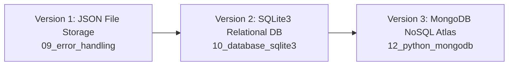

# 🐍 Python Code with Chai

[](https://www.python.org/)
[](https://www.mongodb.com/)
[](LICENSE)
[]()

> A structured, hands-on, and comprehensive Python learning repository covering core language mechanics, Object-Oriented Programming (OOP), metaprogramming with decorators, database integrations (SQLite3 & MongoDB), and API handling, inspired by the popular **"Chai aur Python"** series.

---

## 📑 Table of Contents

- [Overview](#-overview)
- [Repository Structure](#-repository-structure)
- [Module Breakdown](#-module-breakdown)
  - [01. Basics & Data Types](#01-basics--data-types)
  - [02. Conditionals](#02-conditionals)
  - [03. Loops & Flow Control](#03-loops--flow-control)
  - [04. Behind the Scenes: Iteration Tools](#04-behind-the-scenes-iteration-tools)
  - [05. Functions & Deep Dive](#05-functions--deep-dive)
  - [06. Scopes & Closures](#06-scopes--closures)
  - [07. Object-Oriented Programming (OOP)](#07-object-oriented-programming-oop)
  - [08. Decorators](#08-decorators)
  - [09. Error Handling & File I/O](#09-error-handling--file-io)
  - [10. SQLite3 Database Integration](#10-sqlite3-database-integration)
  - [11. Handling Web APIs](#11-handling-web-apis)
  - [12. MongoDB Integration](#12-mongodb-integration)
- [Featured Project: YouTube Video Manager Evolution](#-featured-project-youtube-video-manager-evolution)
- [Getting Started](#-getting-started)
  - [Prerequisites](#prerequisites)
  - [Installation & Setup](#installation--setup)
  - [Running the Code](#running-the-code)
- [Security Best Practices](#-security-best-practices)
- [Contributing](#-contributing)
- [License](#-license)

---

## 🌟 Overview

This repository documents an end-to-end Python mastery path starting from core primitives up through practical backend engineering patterns:

1. **Core Language Fundamentals**: Memory references, mutability vs immutability, inner workings of Python Virtual Machine (PVM) and bytecode.
2. **Logic & Algorithms**: Idiomatic conditional logic, loop patterns, and real-world problem sets.
3. **Advanced Programming Paradigms**: Functional patterns, closures, generators, decorators, and OOP.
4. **Data Persistence & Backends**: File handling (JSON), Relational DBs (SQLite3), and NoSQL DBs (MongoDB Atlas).
5. **Networking**: Consuming public RESTful endpoints with the `requests` ecosystem.

---

## 📂 Repository Structure

```plaintext
python-code-with-chai/
│
├── 01_basics/               # Python setup, bytecode, datatypes & mutability
├── 02_conditionals/         # 10 practical conditional problem solutions
├── 03_loops/                # Loop constructs, iteration controls & algorithms
├── 04_iteration_tools/      # Deep dive into iter(), next(), and iterables
├── 05_functions/            # Functions, *args, **kwargs, lambda, generators, recursion
├── 06_scopes/               # LEGB scope resolution & closure mechanics
├── 07_oop/                  # Classes, encapsulation, inheritance, polymorphism, static/properties
├── 08_decorators/           # Metaprogramming: timer, debugger, and memoization/cache decorators
├── 09_error_handling/       # Try-except-finally blocks, file I/O & CLI YouTube Manager (JSON)
├── 10_database_sqlite3/     # SQLite3 integration with parameterized queries (DB Manager)
├── 11_handling_apis/        # HTTP REST API consumption using requests
├── 12_python_mongodb/       # PyMongo, MongoDB Atlas connection & CRUD operations
├── .gitignore               # Ignored cache, virtual environments, and secrets
└── README.md                # Project documentation
```

---

## 📚 Module Breakdown

### 01. Basics & Data Types

- **Location**: [`01_basics/`](./01_basics/)
- **Concepts**: Python execution model, byte code (`.pyc`), Python Virtual Machine (PVM), mutable vs. immutable objects.
- **Reference**: Detailed data type hierarchy and memory models in [`datatypes.md`](./01_basics/datatypes.md).

### 02. Conditionals

- **Location**: [`02_conditionals/`](./02_conditionals/)
- **Concepts**: Nested decisions, boolean logic, boundary validation, and real-world branching scenarios.
- **Problem Set**: Age categorization, ticket pricing with discount rules, grade calculation, fruit ripeness verification, coffee customizations, and leap year detection.

### 03. Loops & Flow Control

- **Location**: [`03_loops/`](./03_loops/)
- **Concepts**: `for`, `while`, `break`, `continue`, loop `else` clauses, and algorithmic loops.
- **Key Solutions**:
  - Positive number counting & sum of even numbers.
  - Multiplication tables skipping specific iterations.
  - String reversal & detecting first non-repeated character.
  - Factorial calculation with `while`.
  - Input validation loops with retry limits.
  - Prime number verification.
  - Exponential backoff algorithm simulation.

### 04. Behind the Scenes: Iteration Tools

- **Location**: [`04_iteration_tools/`](./04_iteration_tools/)
- **Concepts**: The iteration protocol in Python.
  - How `iter()` and `next()` work under the hood.
  - `StopIteration` exception handling.
  - File pointer iteration vs collection iteration.

### 05. Functions & Deep Dive

- **Location**: [`05_functions/`](./05_functions/)
- **Concepts**: First-class citizen functions, pure functions, and variable parameter handling.
- **Topics Covered**:
  - Multiple return values (tuple unpacking).
  - Polymorphic function arguments.
  - Default parameters & keyword arguments.
  - Anonymous functions (`lambda`).
  - Arbitrary arguments (`*args`) and keyword arguments (`**kwargs`).
  - Generators (`yield`) for memory-efficient iteration.
  - Recursive functions with termination conditions.

### 06. Scopes & Closures

- **Location**: [`06_scopes/`](./06_scopes/)
- **Concepts**: The **LEGB** rule (Local, Enclosing, Global, Built-in).
  - Scope boundaries and variable lifetime.
  - Factory functions and lexical closures.

### 07. Object-Oriented Programming (OOP)

- **Location**: [`07_oop/`](./07_oop/)
- **Concepts**: Industry-standard Object-Oriented design in Python.
  - **Class & Instance**: Initializer (`__init__`) and instance methods.
  - **Encapsulation**: Private attributes (name mangling via `__variable`) and getters.
  - **Inheritance**: Subclasses (`ElectricCar` extending `Car`) and `super()`.
  - **Polymorphism**: Overriding methods (e.g., `fuel_type`).
  - **Class Attributes**: Tracking state across all instances (`total_car`).
  - **Decorators**: `@staticmethod` for utility functions and `@property` for read-only attributes.
  - **Multiple Inheritance** & type verification with `isinstance()`.

### 08. Decorators

- **Location**: [`08_decorators/`](./08_decorators/)
- **Concepts**: Higher-order functions that modify or wrap the execution of other functions.
  - **Execution Timer**: Timing function duration using `time.time()`.
  - **Debug Logger**: Inspecting argument values (`*args`, `**kwargs`) and return values.
  - **Cache / Memoization**: Caching expensive function return values to eliminate redundant computation.

### 09. Error Handling & File I/O

- **Location**: [`09_error_handling/`](./09_error_handling/)
- **Concepts**: Defensive programming with `try`, `except`, `finally`, and context managers (`with open`).
- **Project**: **YouTube Manager CLI (JSON)**
  - Implements persistent CRUD operations saved locally to `youtube.txt` in JSON format.

### 10. SQLite3 Database Integration

- **Location**: [`10_database_sqlite3/`](./10_database_sqlite3/)
- **Concepts**: Embedded relational databases using Python's built-in `sqlite3` driver.
- **Highlights**:
  - Connection management and cursor lifecycle.
  - Table schemas (`id INTEGER PRIMARY KEY`, `name TEXT`, `time TEXT`).
  - Parameterized queries to safeguard against SQL Injection attacks.

### 11. Handling Web APIs

- **Location**: [`11_handling_apis/`](./11_handling_apis/)
- **Concepts**: Interacting with external web services via REST APIs using the `requests` library.
- **Highlights**:
  - HTTP GET requests, status code checking, and response JSON parsing.
  - Extracting nested payload data from FreeAPI endpoints.

### 12. MongoDB Integration

- **Location**: [`12_python_mongodb/`](./12_python_mongodb/)
- **Concepts**: NoSQL document database management using `pymongo`.
- **Highlights**:
  - MongoDB Atlas cluster connections.
  - Working with `ObjectId` for document indexing and queries.
  - Full CRUD operations (`insert_one`, `find`, `update_one`, `delete_one`).

---

## 📽 Featured Project: YouTube Video Manager Evolution

A highlight of this repository is the progressive evolution of a complete CRUD (Create, Read, Update, Delete) application across three different persistence layers:



| Architecture | Storage Mechanism       | Data Format      | Key Technology                  |
| :----------- | :---------------------- | :--------------- | :------------------------------ |
| **Stage 1**  | Local Text File         | JSON             | `json` module, `try/except`     |
| **Stage 2**  | Relational Database     | SQL Rows (`.db`) | Built-in `sqlite3`, SQL queries |
| **Stage 3**  | Cloud Document Database | BSON Documents   | `pymongo`, MongoDB Atlas        |

---

## 🚀 Getting Started

### Prerequisites

- **Python**: Version `3.10` or higher installed ([Download Python](https://www.python.org/downloads/))
- **Git**: Installed and configured on your machine ([Download Git](https://git-scm.com/))

### Installation & Setup

1. **Clone the repository**:

   ```bash
   git clone https://github.com/Aasutosh23/python-code-with-chai.git
   cd python-code-with-chai
   ```

2. **Create and activate a virtual environment** _(recommended)_:
   - **Windows**:
     ```powershell
     python -m venv venv
     .\venv\Scripts\activate
     ```
   - **macOS / Linux**:
     ```bash
     python3 -m venv venv
     source venv/bin/activate
     ```
3. **Install external dependencies**:
   ```bash
   pip install -r requirements.txt
   ```

### Running the Code

You can run any script directly from the project root. Examples:

```bash
# Run basic scripts
python 01_basics/hello_chai.py

# Run conditionals or loop problems
python 02_conditionals/01_solution.py
python 03_loops/01_solution.py

# Run OOP demonstration
python 07_oop/01_solution.py

# Run YouTube Manager (SQLite Version)
python 10_database_sqlite3/youtube_manager_db.py

# Run API handler
python 11_handling_apis/freeapi_username.py
```

---

## 🔒 Security Best Practices

> [!WARNING]
> Never commit sensitive database credentials, passwords, or API keys directly into public repositories.

When connecting to MongoDB or external APIs, keep your credentials secure using environment variables:

1. Create a `.env` file in the project directory (this is already included in `.gitignore`):
   ```env
   MONGODB_URI=mongodb+srv://<username>:<password>@cluster0.example.mongodb.net/
   ```
2. Load environment variables in your Python script:

   ```python
   import os
   from dotenv import load_dotenv
   from pymongo import MongoClient

   load_dotenv()
   mongo_uri = os.getenv("MONGODB_URI")
   client = MongoClient(mongo_uri)
   ```

---

## 🤝 Contributing

Contributions, issues, and feature suggestions are welcome!

1. Fork the Project
2. Create your Feature Branch (`git checkout -b feature/AmazingFeature`)
3. Commit your Changes (`git commit -m 'Add some AmazingFeature'`)
4. Push to the Branch (`git push origin feature/AmazingFeature`)
5. Open a Pull Request

---

## 📄 License

This repository is licensed under the [MIT License](LICENSE). Feel free to use this code for learning and personal projects.
